# Panduan Membaca Skrip Google Colab: Dense Neural Network untuk Klasifikasi Kondisi Motor

Panduan ini dibuat sebagai **pegangan mahasiswa** untuk memahami isi notebook **`Motor_Condition.ipynb`** dan dataset **`Motor_Condition_Data.csv`**. Fokusnya bukan hanya *menjalankan* kode, tetapi juga memahami **apa yang dilakukan setiap bagian skrip, mengapa langkah itu diperlukan, dan konsep teori apa yang berada di baliknya**.

> Kasus: klasifikasi kondisi motor listrik menjadi **NORMAL** atau **FAULT** berdasarkan 6 fitur sensor.

---

## 1. Gambaran umum notebook

Notebook ini mengikuti alur Machine Learning yang sangat umum:

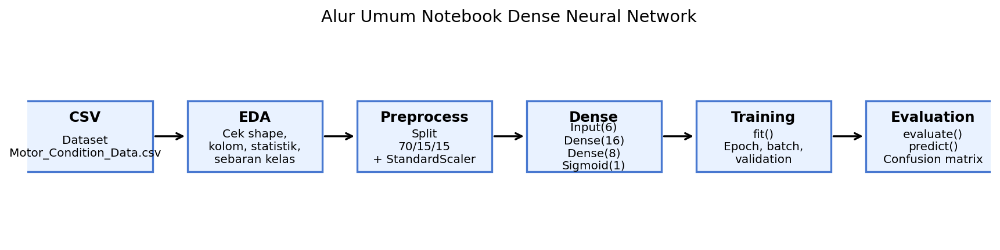

Secara ringkas, notebook melakukan hal berikut:
1. membaca file CSV,
2. mengecek isi dataset,
3. melakukan eksplorasi awal,
4. membagi data menjadi train/validation/test,
5. melakukan standardisasi fitur,
6. membangun model **Dense Neural Network**,
7. melatih model,
8. mengevaluasi hasil,
9. mencoba prediksi data baru.

---

## 2. Dataset yang digunakan

File data: **`Motor_Condition_Data.csv`**

Kolom pada dataset:
- `sample_id` → hanya ID sampel, **bukan fitur prediksi**.
- `voltage_v` → tegangan motor.
- `current_a` → arus motor.
- `temperature_c` → temperatur motor.
- `vibration_mm_s` → getaran motor.
- `rpm` → putaran motor.
- `load_pct` → beban motor.
- `condition` → label kelas (`NORMAL` atau `FAULT`).

Visualisasi awal dataset:

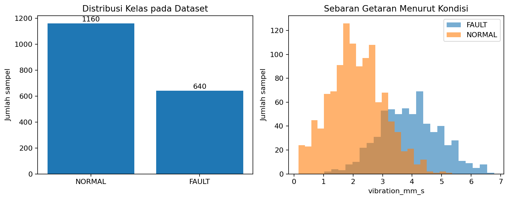

**Interpretasi penting:**
- Kelas **NORMAL** lebih banyak daripada **FAULT**.
- Sebaran `vibration_mm_s` untuk kedua kelas saling tumpang tindih. Ini berarti model **tidak bisa hanya mengandalkan satu fitur saja**, dan akurasi 100% memang tidak otomatis tercapai.

---

## 3. Bagian Persiapan Colab

### Kode penting
```python
from google.colab import drive
drive.mount('/content/drive')
```

### Apa fungsinya?
Kode ini dipakai untuk **menghubungkan Google Colab dengan Google Drive**. Dengan begitu, notebook dapat membaca file CSV yang disimpan di Drive.

### Catatan untuk mahasiswa
- Kode ini **khusus** lingkungan Google Colab.
- Jika notebook dijalankan di Jupyter lokal, bagian ini bisa diubah atau dihapus.

### Kode import utama
```python
import numpy as np
import pandas as pd
import matplotlib.pyplot as plt
import tensorflow as tf
```

**Penjelasan library:**
- **NumPy** → operasi array dan numerik.
- **Pandas** → membaca dan mengolah data tabular.
- **Matplotlib** → membuat grafik.
- **TensorFlow** → membangun dan melatih Neural Network.

---

## 4. Membaca dataset

### Kode
```python
df = pd.read_csv(file_name)
print('Ukuran data:', df.shape)
display(df.head(8))
print('Nama kolom:', df.columns.tolist())
```

### Penjelasan
- `pd.read_csv(...)` membaca file CSV ke dalam **DataFrame** Pandas.
- `df.shape` menampilkan ukuran data dalam bentuk `(jumlah_baris, jumlah_kolom)`.
- `df.head(8)` menampilkan 8 baris pertama.
- `df.columns.tolist()` menampilkan nama-nama kolom.

### Mengapa langkah ini penting?
Sebelum membangun model, kita harus memastikan:
- file berhasil dibaca,
- kolom yang dibutuhkan memang ada,
- tidak ada nama kolom yang salah,
- data tampak masuk akal.

---

## 5. Eksplorasi Data (EDA)

### Kode inti
```python
df.info()
display(df.describe(include='all').T)
print(df.isna().sum())
print(df['condition'].value_counts())
```

### Fungsi setiap perintah
- `df.info()` → tipe data tiap kolom dan jumlah data non-null.
- `df.describe()` → statistik ringkas seperti mean, std, min, max.
- `df.isna().sum()` → jumlah missing values tiap kolom.
- `value_counts()` → jumlah tiap kelas.

### Mengapa EDA diperlukan?
EDA membantu menjawab pertanyaan berikut:
- Apakah ada **missing values**?
- Apakah distribusi kelas seimbang?
- Apakah nilai sensor berada pada rentang yang masuk akal?
- Apakah ada indikasi fitur tertentu dapat membantu pemisahan kelas?

> Meskipun dataset ini bersih, EDA tetap wajib dilakukan. Pada data nyata, masalah sering ditemukan justru pada tahap ini.

---

## 6. Menentukan fitur input dan target

Pada notebook, fitur dipilih dengan:
```python
features = ['voltage_v', 'current_a', 'temperature_c', 'vibration_mm_s', 'rpm', 'load_pct']
```

Lalu dibuat:
```python
X = df[features].copy()
y = df['condition'].map({'NORMAL': 0, 'FAULT': 1}).astype(int)
```

### Maknanya
- `X` = matriks fitur input.
- `y` = label target.
- Label diubah menjadi angka:
  - `NORMAL = 0`
  - `FAULT = 1`

### Kenapa label diubah menjadi angka?
Model Neural Network bekerja dengan angka, bukan string teks.

### Catatan penting
Dalam klasifikasi biner ini:
- kelas **0** dianggap sebagai **negative class**,
- kelas **1** dianggap sebagai **positive class**.

Jadi:
- Negative = NORMAL
- Positive = FAULT

---

## 7. Train / Validation / Test Split

### Kode
```python
X_train, X_temp, y_train, y_temp = train_test_split(
    X, y, test_size=0.30, random_state=42, stratify=y
)
X_val, X_test, y_val, y_test = train_test_split(
    X_temp, y_temp, test_size=0.50, random_state=42, stratify=y_temp
)
```

Visualisasinya:

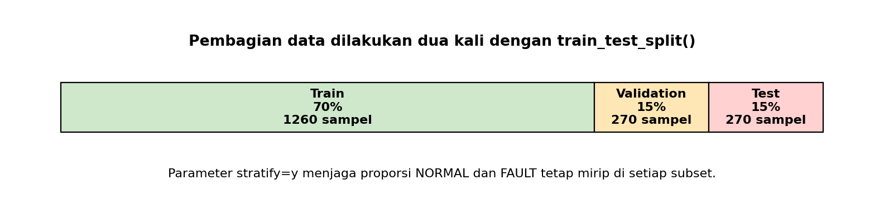

### Penjelasan
Notebook membagi data menjadi 3 bagian:
- **Training set (70%)** → dipakai untuk melatih model.
- **Validation set (15%)** → dipakai untuk memantau performa saat training.
- **Test set (15%)** → dipakai untuk evaluasi akhir.

### Mengapa ada `X_temp`?
Karena fungsi `train_test_split()` membagi data menjadi dua bagian setiap kali dipanggil. Maka 30% data “sisa” disimpan sementara di `X_temp` lalu dibagi lagi menjadi validation dan test.

### Arti parameter penting
- `test_size=0.30` → 30% data dipisahkan dari training.
- `random_state=42` → hasil split dapat diulang dengan susunan yang sama.
- `stratify=y` → menjaga proporsi NORMAL dan FAULT agar tetap mirip di setiap subset.

---

## 8. StandardScaler

### Kode
```python
scaler = StandardScaler()
X_train_scaled = scaler.fit_transform(X_train)
X_val_scaled = scaler.transform(X_val)
X_test_scaled = scaler.transform(X_test)
```

Visualisasi contoh fitur `current_a`:

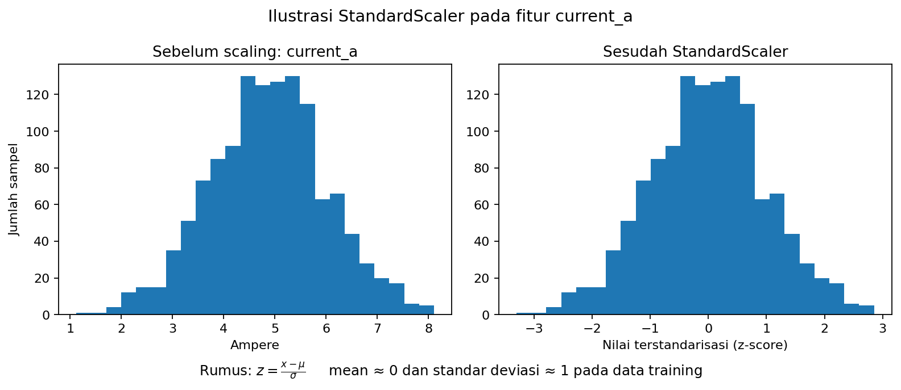

### Konsep teori
StandardScaler mengubah fitur dengan rumus:

$$
z = \frac{{x - \mu}}{{\sigma}}
$$

Keterangan:
- $x$ = nilai asli,
- $\mu$ = rata-rata pada data training,
- $\sigma$ = standar deviasi pada data training,
- $z$ = nilai hasil standardisasi.

### Mengapa scaling diperlukan?
Karena fitur kita berada pada skala berbeda:
- tegangan sekitar 200-an,
- arus sekitar 1–9,
- getaran sekitar 0–6,
- rpm sekitar 1200–1500.

Jika tidak diskalakan, fitur berskala besar dapat mendominasi proses pembelajaran.

### Kenapa `fit_transform()` hanya pada training set?
Agar tidak terjadi **data leakage**.

- `fit_transform(X_train)` → scaler belajar mean dan std dari training set.
- `transform(X_val)` dan `transform(X_test)` → validation/test hanya **mengikuti** skala training set.

---

## 9. Membangun model Dense Neural Network

### Kode
```python
model = tf.keras.Sequential([
    tf.keras.Input(shape=(len(features),)),
    tf.keras.layers.Dense(16, activation='relu'),
    tf.keras.layers.Dense(8, activation='relu'),
    tf.keras.layers.Dense(1, activation='sigmoid'),
])
```

Arsitekturnya:

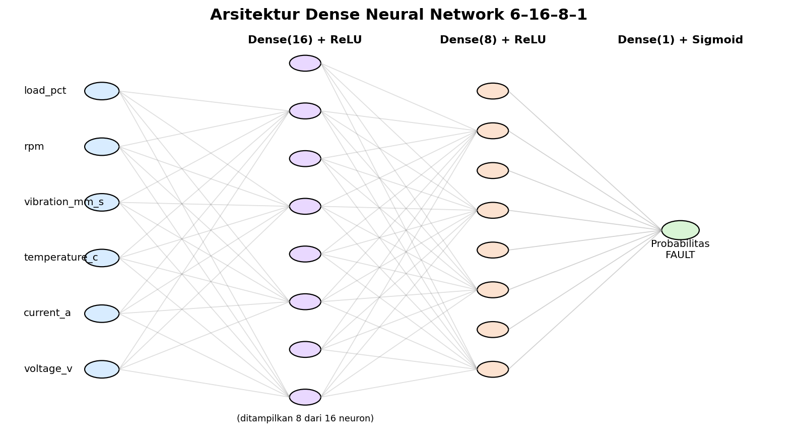

### Penjelasan ukuran input
Karena `features` berisi 6 kolom, maka:
```python
len(features) = 6
```
Sehingga input model adalah:
$$
\text{{Input shape}} = (6,)
$$
Artinya, **setiap sampel data memiliki 6 fitur input**.

### Penjelasan layer
- `Dense(16, activation='relu')` → hidden layer pertama dengan 16 neuron.
- `Dense(8, activation='relu')` → hidden layer kedua dengan 8 neuron.
- `Dense(1, activation='sigmoid')` → output layer dengan 1 neuron untuk menghasilkan probabilitas kelas FAULT.

### Kenapa output hanya 1 neuron?
Untuk klasifikasi biner, satu neuron sigmoid sudah cukup karena hasilnya dapat ditafsirkan sebagai:
$$
p = P(\text{{FAULT}}|x)
$$
Jika `p ≥ 0.5`, kita prediksi **FAULT**. Jika `p < 0.5`, kita prediksi **NORMAL**.

---

## 10. Fungsi aktivasi ReLU

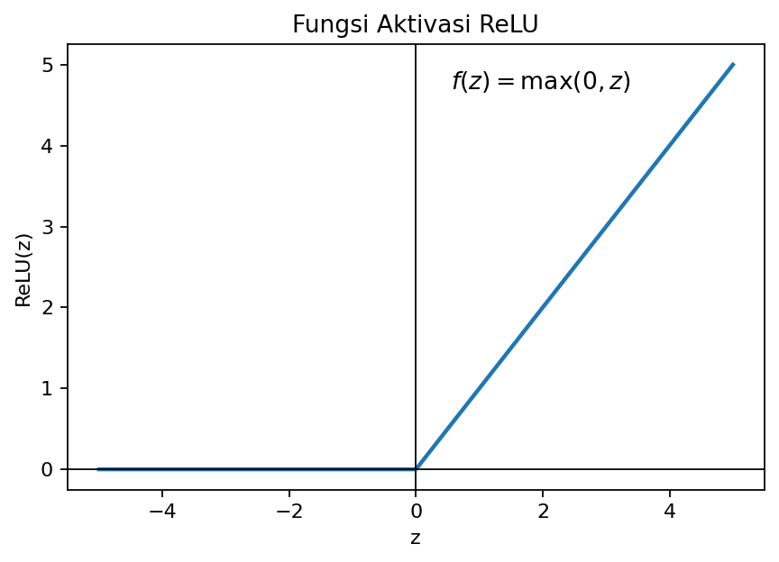

Rumus ReLU:
$$
f(z) = \max(0, z)
$$

### Mengapa ReLU digunakan di hidden layer?
- sederhana,
- cepat dihitung,
- membantu model mempelajari hubungan nonlinier,
- sering bekerja baik untuk banyak kasus praktis.

Jika nilai $z$ negatif, keluarannya 0. Jika positif, nilainya diteruskan.

---

## 11. Fungsi aktivasi Sigmoid

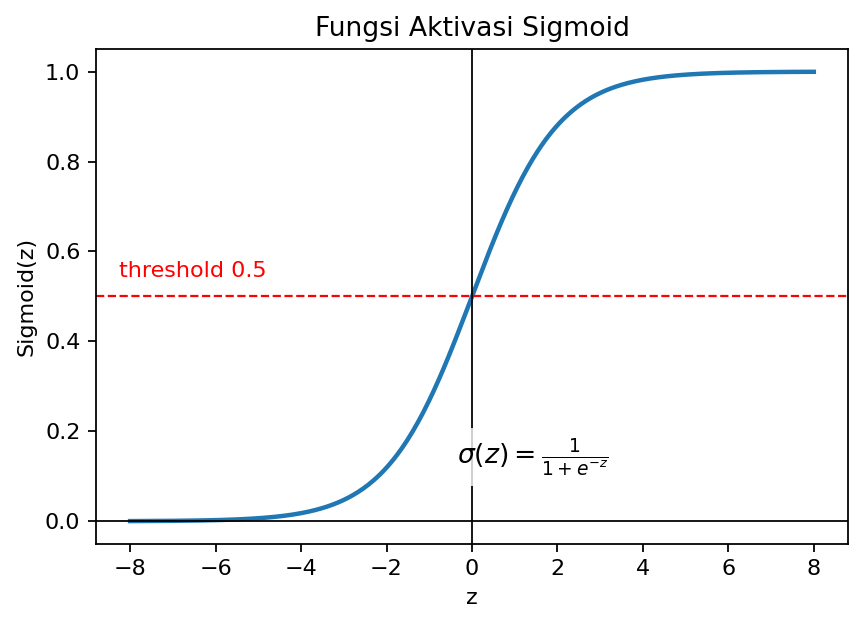

Rumus sigmoid:
$$
\sigma(z) = \frac{{1}}{{1 + e^{{-z}}}}
$$

### Sifat penting sigmoid
- Output selalu di antara **0 dan 1**.
- Sangat cocok untuk **probabilitas**.
- Dalam notebook ini, sigmoid digunakan untuk memperkirakan peluang motor berada pada kondisi **FAULT**.

Visual ambang keputusan:

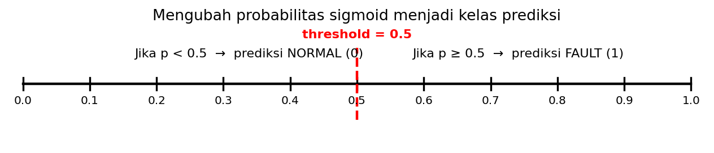

---

## 12. Jumlah parameter model

Untuk layer Dense, jumlah parameter dapat dihitung dengan:
$$
\text{{parameter}} = (\text{{jumlah input}} \times \text{{jumlah neuron}}) + \text{{jumlah bias}}
$$

### Perhitungan pada model ini
1. **Layer 1: Dense(16)**
   $$
   (6 \times 16) + 16 = 112
   $$
2. **Layer 2: Dense(8)**
   $$
   (16 \times 8) + 8 = 136
   $$
3. **Layer Output: Dense(1)**
   $$
   (8 \times 1) + 1 = 9
   $$

Total parameter:
$$
112 + 136 + 9 = 257
$$

Semua parameter ini akan dipelajari selama training.

---

## 13. Compile model

### Kode
```python
model.compile(
    optimizer=tf.keras.optimizers.Adam(learning_rate=0.001),
    loss='binary_crossentropy',
    metrics=['accuracy']
)
```

### Penjelasan
`compile()` menentukan **bagaimana model belajar**.

- **optimizer** → cara memperbarui bobot.
- **loss** → ukuran kesalahan yang ingin diperkecil.
- **metrics** → ukuran kinerja yang ingin ditampilkan.

### Mengapa memakai Adam?
Adam adalah optimizer yang populer karena:
- cukup stabil,
- biasanya bekerja baik tanpa banyak tuning,
- cocok sebagai pilihan awal untuk pembelajaran.

---

## 14. Binary Cross-Entropy Loss

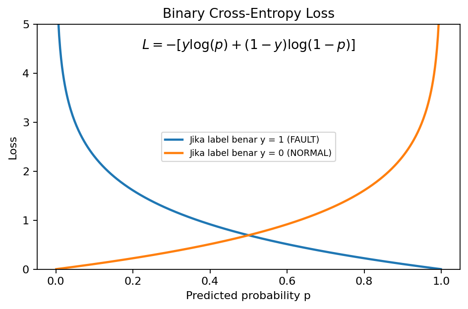

Rumus binary cross-entropy:
$$
L = -\left[y\log(p) + (1-y)\log(1-p)\right]
$$

Keterangan:
- $y$ = label benar (0 atau 1),
- $p$ = probabilitas prediksi kelas 1 (FAULT).

### Intuisi
- Jika label benar adalah FAULT ($y=1$) dan model memberi probabilitas tinggi untuk FAULT, loss kecil.
- Jika label benar FAULT tetapi probabilitas prediksi kecil, loss besar.
- Hal yang sama berlaku terbalik untuk kelas NORMAL.

---

## 15. Training model dengan `fit()`

### Kode
```python
history = model.fit(
    X_train_scaled, y_train,
    validation_data=(X_val_scaled, y_val),
    epochs=35, batch_size=32, verbose=1
)
```

Ilustrasi epoch dan batch:

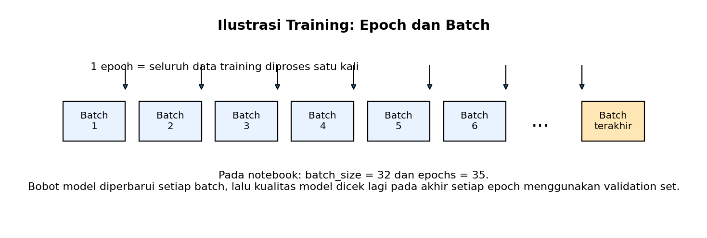

### Arti setiap bagian
- `X_train_scaled, y_train` → data untuk melatih model.
- `validation_data=(X_val_scaled, y_val)` → data validasi.
- `epochs=35` → seluruh training set diulang sebanyak 35 kali.
- `batch_size=32` → data diproses per 32 sampel setiap langkah.
- `verbose=1` → menampilkan progres training.

### Apa itu `history`?
Objek `history` menyimpan riwayat training, misalnya:
- `loss`
- `accuracy`
- `val_loss`
- `val_accuracy`

Objek inilah yang kemudian dipakai untuk membuat grafik training.

---

## 16. Grafik training dan validation

### Kode
```python
hist = pd.DataFrame(history.history)
hist[['loss', 'val_loss']].plot(...)
hist[['accuracy', 'val_accuracy']].plot(...)
```

### Tujuannya
Grafik ini dipakai untuk melihat:
- apakah model belajar dengan baik,
- apakah validation performance membaik,
- apakah ada tanda **overfitting**.

### Indikasi overfitting
Overfitting biasanya terlihat ketika:
- `loss` training terus turun,
- tetapi `val_loss` berhenti membaik atau justru naik.

---

## 17. Evaluasi akhir pada test set

### Kode penting
```python
loss, acc = model.evaluate(X_test_scaled, y_test, verbose=0)
proba = model.predict(X_test_scaled, verbose=0).ravel()
pred = (proba >= 0.5).astype(int)
```

### Penjelasan
- `evaluate()` → menghitung loss dan accuracy langsung dari TensorFlow.
- `predict()` → menghasilkan probabilitas sigmoid.
- `.ravel()` → mengubah bentuk array dari `(n,1)` menjadi `(n,)` agar lebih mudah dipakai.
- `(proba >= 0.5).astype(int)` → mengubah probabilitas menjadi kelas 0/1.

### Kenapa bisa langsung `predict()` tanpa `evaluate()`?
Bisa. Keduanya tidak saling bergantung. Namun pada notebook ini, `evaluate()` dipakai untuk ringkasan cepat, sedangkan `predict()` dipakai untuk analisis lebih lanjut seperti confusion matrix dan classification report.

---

## 18. Confusion Matrix

Struktur confusion matrix untuk binary classification:

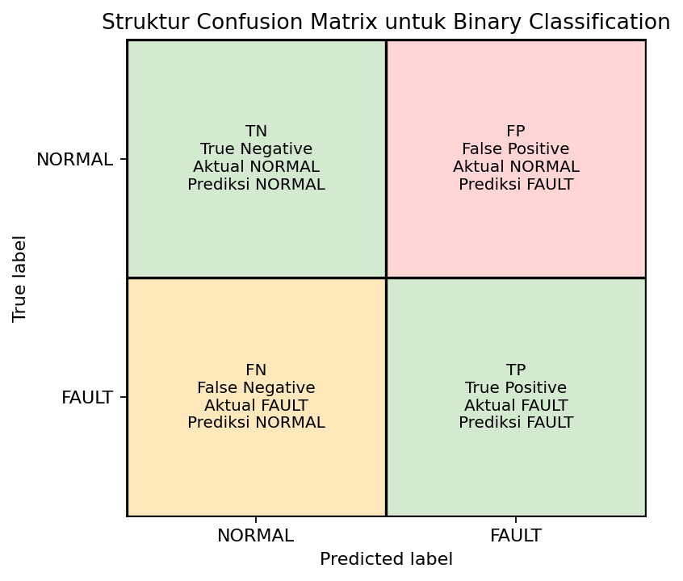

### Makna istilah
- **TN (True Negative)** → aktual NORMAL, diprediksi NORMAL.
- **FP (False Positive)** → aktual NORMAL, diprediksi FAULT.
- **FN (False Negative)** → aktual FAULT, diprediksi NORMAL.
- **TP (True Positive)** → aktual FAULT, diprediksi FAULT.

### Mengapa confusion matrix penting?
Karena accuracy saja tidak cukup. Dalam fault detection, misalnya, **FN** sering lebih berbahaya daripada FP karena kerusakan nyata tidak terdeteksi.

---

## 19. Precision, Recall, dan F1-score

Notebook menampilkan:
```python
print(classification_report(y_test, pred, target_names=['NORMAL', 'FAULT'], digits=3))
```

### Rumus dasar
$$
\text{{Accuracy}} = \frac{{TP + TN}}{{TP + TN + FP + FN}}
$$

$$
\text{{Precision}} = \frac{{TP}}{{TP + FP}}
$$

$$
\text{{Recall}} = \frac{{TP}}{{TP + FN}}
$$

$$
F1 = \frac{{2 \cdot Precision \cdot Recall}}{{Precision + Recall}}
$$

### Interpretasi singkat
- **Accuracy** → proporsi prediksi yang benar secara keseluruhan.
- **Precision** → dari semua prediksi FAULT, berapa yang benar-benar FAULT?
- **Recall** → dari semua FAULT yang benar, berapa yang berhasil dideteksi?
- **F1-score** → keseimbangan precision dan recall.

---

## 20. Prediksi sampel baru

### Kode
```python
new_samples = pd.DataFrame([...])[features]
new_scaled = scaler.transform(new_samples)
new_probability = model.predict(new_scaled, verbose=0).ravel()
```

### Langkah-langkah penting
1. Buat DataFrame sampel baru.
2. Pastikan urutan kolom sama persis dengan `features`.
3. Terapkan **scaler yang sama** seperti training.
4. Jalankan `model.predict()`.
5. Ubah probabilitas menjadi label kelas.

### Kenapa tidak boleh `fit_transform()` lagi?
Karena data baru harus diproyeksikan ke skala yang **sama dengan training set**, bukan membuat skala baru.

---

## 21. Eksperimen mandiri yang sangat disarankan

Notebook menutup dengan tiga eksperimen:
1. Ubah jumlah neuron hidden layer pertama.
2. Ubah jumlah epoch.
3. Coba tanpa StandardScaler.

### Nilai edukatif eksperimen ini
Mahasiswa akan belajar bahwa:
- model yang lebih besar belum tentu lebih baik,
- epoch terlalu banyak dapat menyebabkan overfitting,
- preprocessing sangat memengaruhi performa model.

---

## 22. Ringkasan konsep utama

### Konsep teknis yang dipelajari dari notebook ini
- membaca data dengan Pandas,
- EDA dasar,
- train/validation/test split,
- standardisasi dengan StandardScaler,
- arsitektur Dense Neural Network,
- fungsi aktivasi ReLU dan sigmoid,
- binary cross-entropy,
- training dengan `fit()`,
- evaluasi dengan confusion matrix dan classification report,
- prediksi data baru.

### Inti pesan untuk mahasiswa
Notebook ini bukan hanya latihan menjalankan TensorFlow, tetapi juga latihan memahami **alur berpikir Machine Learning**:
1. data harus diperiksa,
2. data harus dipersiapkan,
3. model harus dibangun dengan alasan yang jelas,
4. hasil harus dievaluasi dengan metrik yang tepat,
5. prediksi harus diinterpretasikan secara hati-hati.

---

## 23. Referensi cepat sintaks penting

```python
# membaca data
df = pd.read_csv(file_name)

# memilih fitur dan target
X = df[features]
y = df['condition'].map({'NORMAL': 0, 'FAULT': 1}).astype(int)

# split data
X_train, X_temp, y_train, y_temp = train_test_split(...)
X_val, X_test, y_val, y_test = train_test_split(...)

# scaling
scaler = StandardScaler()
X_train_scaled = scaler.fit_transform(X_train)
X_val_scaled = scaler.transform(X_val)
X_test_scaled = scaler.transform(X_test)

# model
model = tf.keras.Sequential([
    tf.keras.Input(shape=(6,)),
    tf.keras.layers.Dense(16, activation='relu'),
    tf.keras.layers.Dense(8, activation='relu'),
    tf.keras.layers.Dense(1, activation='sigmoid')
])

# compile
model.compile(optimizer='adam', loss='binary_crossentropy', metrics=['accuracy'])

# training
history = model.fit(...)

# evaluasi dan prediksi
loss, acc = model.evaluate(...)
proba = model.predict(...).ravel()
pred = (proba >= 0.5).astype(int)
```

---
